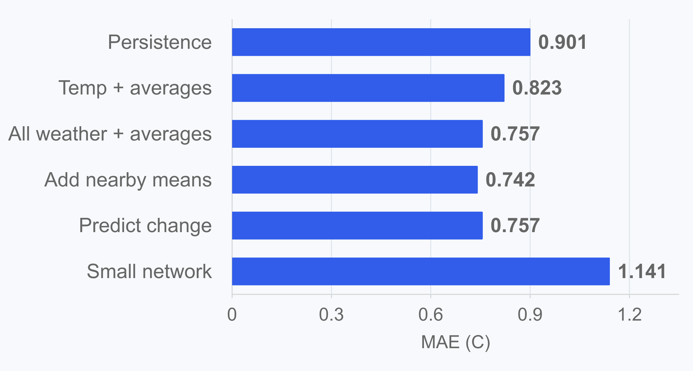

# Weather Prediction Near Irvine

Constantine Su | AI SCI 290A

## Project materials

| Item | Link |
| --- | --- |
| Results, plots, and what I learned | [Notebooks](notebooks/) and [Plots](plots/) |
| Code and saved outputs | [Notebooks](notebooks/) |
| Slides | [Canva presentation](https://www.canva.com/d/fS7VQVGeyOhkQMm) |
| Presentation video | [Watch on YouTube (4 min 37 sec)](https://youtu.be/yJGBQWXjlaQ) |

## 1. The question

Can today's weather help me predict tomorrow's temperature, wind, and precipitation near Irvine? Can I also predict hot days, or look two or three days ahead?

I use ERA5 data from 2009-2010 at **33.75 N, 117.75 W**. This is one point on a weather grid near Irvine. I make predictions after today's daily weather values are available.

## 2. Exploratory

I started by playing around with maps and line plots. Then I plotted temperature and precipitation at the Irvine point over time. I also made 3-day and 7-day averages of temperature, pressure, u, v, and precipitation to see whether recent weather might help.

Some things needed a closer look. I zoomed in on a pressure dip before keeping it. For precipitation, June had more positive values than February in 2009, but those values were much smaller. Counting days above zero did not tell the whole story.

The notebooks include the model scores and my observations. All the saved plots are in [plots](plots/).

## 3. Baseline and models

I start with persistence: predict that tomorrow will be the same as today. Then I try linear regression with recent averages, other weather variables, and nearby points. I also try predicting the change and using a small neural network. For positive-or-zero precipitation and hot days, I use logistic regression.

I check three periods: Jan-Feb, Mar-Apr, and May-Jun 2010. Each time, I train on earlier days. Any scaling and hot-day cutoff come from training data only. For two- and three-day predictions, I also check that the training answers would already be known when I make the first forecast.

These results use the same **181 validation days**:

| What I tried | What happened |
| --- | --- |
| Temperature: persistence | MAE 0.901 C, RMSE 1.148 C |
| Temperature: weather averages and nearby points | MAE 0.742 C, RMSE 0.954 C |
| Predict the temperature change | Same linear predictions as predicting tomorrow directly |
| A small neural network | Worse than linear regression in this trial |
| Temperature two and three days ahead | Both beat persistence; RMSE rises to 1.657 and 1.941 C |
| Predict the precipitation value | Nearby points give the lowest RMSE; always zero gives the lowest MAE |
| Predict hot days | Only five hot validation days; logistic regression finds one and persistence finds two |

Adding more inputs did not always help. Pressure barely changed the temperature scores, and wind helped overall but made May-June worse.

## 4. Status

| Notebook | What I worked on |
| --- | --- |
| [01_data_audit](notebooks/01_data_audit.ipynb) | Loading and checking the files |
| [02_temperature_only_v1](notebooks/02_temperature_only_v1.ipynb) | Temperature plots, persistence, linear regression, and averages |
| [03_temperature_and_other_variables](notebooks/03_temperature_and_other_variables.ipynb) | More weather inputs, nearby points, temperature change, a small network, longer predictions, and hot days |
| [04_wind_prediction](notebooks/04_wind_prediction.ipynb) | Predicting u and v, then trying averages and pressure |
| [05_precipitation_prediction](notebooks/05_precipitation_prediction.ipynb) | Exploring precipitation, predicting positive or zero, and predicting the values |
| [06_final_evaluation](notebooks/06_final_evaluation.ipynb) | Checking the earlier chosen models on July-December 2010 |
